<a href="https://subunit.ai">
<picture><source media="(prefers-color-scheme: dark)" srcset="assets/banner-dark.svg"></picture>
</a>

**Subunit entwickelt KI-Agentensysteme, intelligentes Wissensmanagement, Automatisierungen und maßgeschneiderte Software für Unternehmen.**

Wir bauen Systeme, die im Arbeitsalltag tragen, nicht nur in der Demo.

### Produkte

<a href="https://subunit.ai/produkte/subunit-os/"><picture><source media="(prefers-color-scheme: dark)" srcset="assets/card-1-dark.svg"></picture></a>
<a href="https://subunit.ai/echo/"><picture><source media="(prefers-color-scheme: dark)" srcset="assets/card-2-dark.svg"></picture></a>
<a href="https://subunit.ai/produkte/"><picture><source media="(prefers-color-scheme: dark)" srcset="assets/card-3-dark.svg"></picture></a>

### Leistungen

[KI-Wissensmanagement](https://subunit.ai/leistungen/ki-wissensmanagement/) ·
[Automatisierungen](https://subunit.ai/leistungen/automatisierungen/) ·
[Individuelle Software & Apps](https://subunit.ai/leistungen/individuelle-software/) ·
[Webdesign](https://subunit.ai/leistungen/webdesign/)

### Wie wir arbeiten

- **Ganz oder gar nicht.** Eine Funktion geht erst raus, wenn alles dazu verdrahtet, ausgeliefert und geprüft ist.
- **Beweisen statt behaupten.** Jede Auslieferung durchläuft vorher eine unabhängige Prüfung.
- **Menschen entscheiden, Agenten bauen.** Wir geben Richtung und Abnahme vor, KI-Agenten übernehmen die Fleißarbeit.

Unsere Produkte entwickeln wir in privaten Repositories.

### Kontakt

[subunit.ai](https://subunit.ai) · [Kontakt](https://subunit.ai/kontakt/) · [info@subunit.ai](mailto:info@subunit.ai) · [Impressum](https://subunit.ai/impressum/)

Subunit UG (haftungsbeschränkt) · Teltow · Made in Germany
